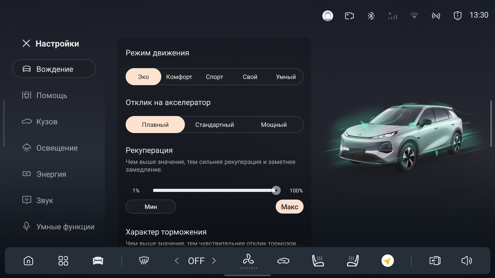

# Changan Qiyuan Q05 LU+ — русификация и доработки

Бесплатный проект для **Changan Qiyuan Q05 Laser Ultra Plus**. Перевод центрального экрана и приборки, навигация, озвучка и доработки штатных приложений.

[Все релизы](https://github.com/LuckDMST/qiyuan-q05-mods/releases) · [Таблицы перевода](translations/) · [Сообщить об ошибке](https://github.com/LuckDMST/qiyuan-q05-mods/issues)

## Скачать модули

Обновлено 24 ноября 2026 года. Пять Android APK ниже опубликованы как предварительные выпуски. Объём проверки указан на странице каждого модуля. Проверки выполнены на одном Q05 LU+ с ГУ B216, Android 14, сборка `SWC.1371.RB216000004`.

| Модуль | Опубликованный выпуск |
| --- | --- |
| [Русский интерфейс](docs/modules/russian-ui.md) | [code349](https://github.com/LuckDMST/qiyuan-q05-mods/releases/tag/russian-ui-code349) |
| [Навигация на приборке](docs/modules/cluster-navigation.md) | [code56](https://github.com/LuckDMST/qiyuan-q05-mods/releases/tag/yandex-cluster-0.56-test) |
| [Интерфейс и настройки](docs/modules/interface-tweaks.md) | [code52](https://github.com/LuckDMST/qiyuan-q05-mods/releases/tag/interface-tweaks-code52) |
| [Рабочая область](docs/modules/app-workspace.md) | [code7](https://github.com/LuckDMST/qiyuan-q05-mods/releases/tag/app-workspace-code7) |
| [Русская озвучка](docs/modules/russian-voice.md) | [code10](https://github.com/LuckDMST/qiyuan-q05-mods/releases/tag/alice-voice-code10) |
| [Русский интерфейс нативной приборки](docs/modules/native-cluster.md) | [Установщик Windows x64](https://github.com/LuckDMST/qiyuan-q05-mods/releases/tag/cluster-native-ru-2026-11-21_04) · [Архив ресурсов Linux HMI](https://github.com/LuckDMST/qiyuan-q05-mods/releases/tag/cluster-native-ru-2026-11-16_14) |

## Скриншоты

[Русские экраны, 23.11.2026](screenshots/russian-ui/2026-11-23/README.md) · [Приборка до и после перевода](docs/modules/native-cluster.md#скриншоты-до-и-после)

## Другие работы

[Наружная озвучка зарядки](docs/modules/exterior-charge-voice.md) · [Голосовой ввод Dicio](docs/modules/dicio-voice-input.md) · [Перевод кругового обзора AVM](docs/modules/avm-magisk.md)

Q05 Сервис проверяет версии опубликованных Android-модулей по [каталогу обновлений](updates/modules.json). Тестовая сборка приложения code25 пока проходит локальную проверку пакета. Каталог не устанавливает модули автоматически.

## Таблицы перевода

В репозитории доступны таблицы TSV. Имя файла соответствует пакету Android. Среди приложений есть настройки автомобиля, климат, системный интерфейс, лаунчер, мультимедиа, телефон и редактор сценариев. [Открыть таблицы](translations/)

В каждой строке пять полей, разделённых табуляцией: полное имя ресурса, индекс элемента массива (`-1` для обычной строки), исходный текст, зарезервированное поле и русский перевод. При редактуре сохраняйте имя ресурса, индекс, исходный текст и параметры форматирования.

При сообщении об ошибке укажите модель и сборку ГУ, версию модуля, путь к экрану и проблемный текст. Если прикладываете скриншот, уберите VIN, имена и данные аккаунтов. [Открыть Issues](https://github.com/LuckDMST/qiyuan-q05-mods/issues)

## Благодарности

Исходный модуль **Q05 RU** разработал **PavelAravin**. **LuckDMST** развивает адресный перевод штатных приложений, исправляет подписи и разметку, ведёт проверку на автомобиле и готовит отдельные модули. [Оригинальный проект на GitVerse](https://gitverse.ru/PavelAravin/q05ru)
