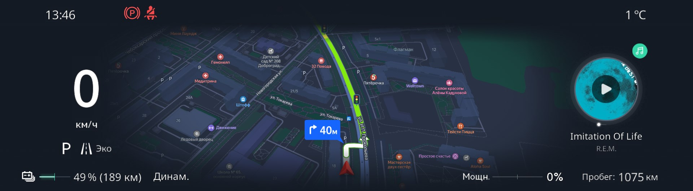

# Навигация на приборке

[Все модули](../../README.md)

Модуль выводит карту Яндекс Навигатора и 2ГИС на водительскую приборку. Для переключения отображения используется трёхпальцевый жест на центральном экране.

## Скачать

[Скачать APK code56](https://github.com/LuckDMST/qiyuan-q05-mods/releases/download/yandex-cluster-0.56-test/qiyuan-q05-yandex-cluster-0.56-test.apk) · [Описание выпуска](https://github.com/LuckDMST/qiyuan-q05-mods/releases/tag/yandex-cluster-0.56-test)

SHA-256 APK: `286E5D0005F37DEA6351CF31A0DDF218E1EEE5876C4D790462A801F133D0039F`.

## Что понадобится

- ГУ B216 с настроенным LSPosed.
- Установленный Яндекс Навигатор или 2ГИС.
- Автомобиль на стоянке для проверки.

## Установка и использование

1. Установите APK и включите его в LSPosed для рекомендованной в модуле области.
2. Не включайте одновременно старый пакет `ru.q05clean.yandexswipe`.
3. Откройте Яндекс Навигатор или 2ГИС и проверьте карту на приборке.
4. Чтобы переключить вывод, используйте трёхпальцевый жест на центральном экране.
5. После сворачивания приложения проверьте, продолжает ли карта отображаться.

На code56 положение карты Яндекса проверено. Карта остаётся на приборке после сворачивания Яндекс Навигатора. Для 2ГИС этот сценарий пока не работает.

[Предыдущий выпуск code52](https://github.com/LuckDMST/qiyuan-q05-mods/releases/tag/yandex-cluster-0.52-test).