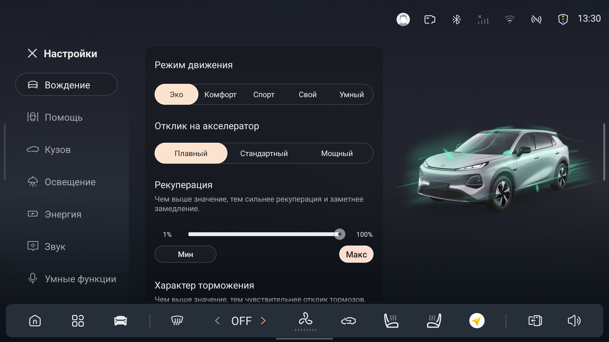

# Русский интерфейс Qiyuan Q05

[Все модули](../../README.md)

Модуль переводит подписи штатных приложений на центральном экране. Русские строки доступны в настройках автомобиля, климате, шторке, мультимедиа, телефоне, камере и редакторе сценариев.

## Скачать

[Скачать APK](https://github.com/LuckDMST/qiyuan-q05-mods/releases/download/russian-ui-code349/qiyuan-q05-russian-ui-code349.apk) · [Описание выпуска](https://github.com/LuckDMST/qiyuan-q05-mods/releases/tag/russian-ui-code349)

SHA-256 APK: `13B00E914FEC9AC9B75EB76634BBEC8C7ED77CCB48AD7AE0384A48EB88D1E4E6`.

## Что понадобится

- ГУ B216 с настроенным LSPosed.
- Свободная область LSPosed для Qiyuan Q05 Russian UI.

## Установка и обновление

1. Установите APK и включите его в LSPosed.
2. Выберите приложения автомобиля, которые нужно переводить.
3. После первой установки перезапустите затронутые приложения, чтобы они загрузили перевод.
4. При обновлении APK не удаляйте рабочие таблицы TSV. Установка APK сама по себе не обновляет их. Перед переносом новых строк выполните отдельную синхронизацию таблиц по инструкции проекта.
5. Проверяйте подписи на стоянке.

## Что проверено

На B216 проверена страница «Вождение» после синхронизации таблиц. Другие экраны проверены частично. Этот выпуск не является полным переводом всех экранов.

## Примеры экранов

[Открыть галерею](../../screenshots/russian-ui/2026-11-23/README.md).

[Таблицы TSV](../../translations/).