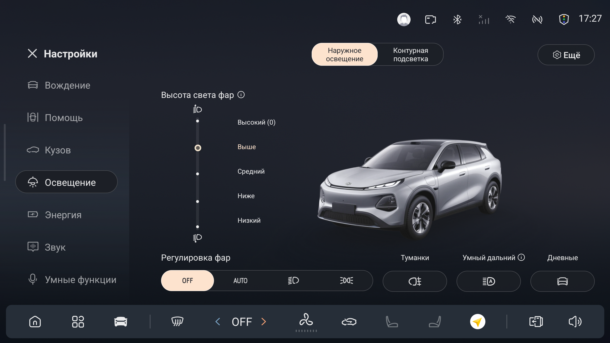
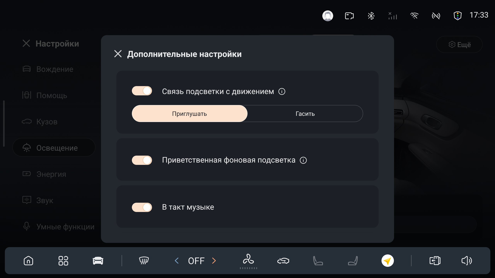
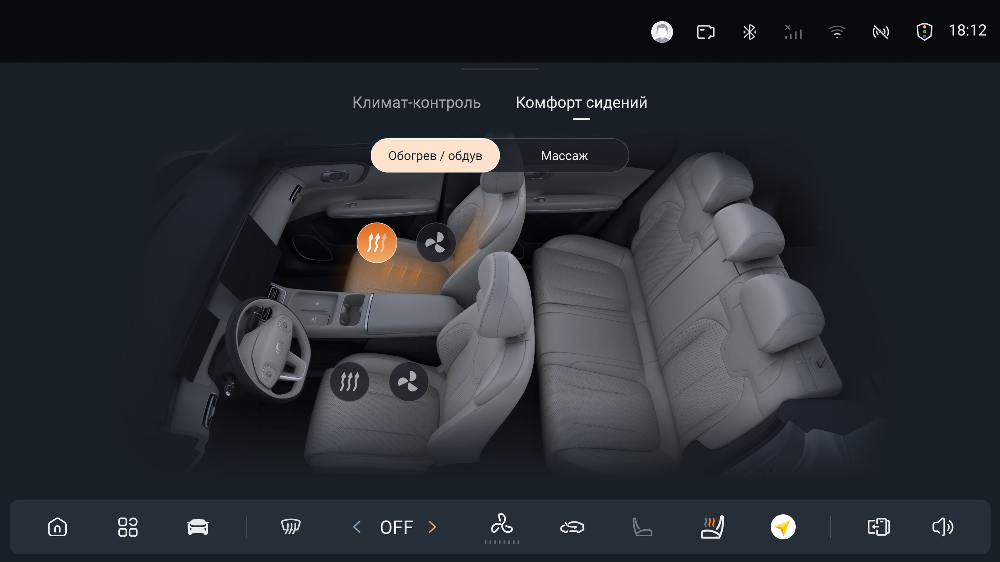

# Qiyuan Q05 Russian UI

[Все модули](../../README.md)

Русификация штатных приложений на центральном экране. Модуль LSPosed включает базовый словарь Q05 RU и адресные правки для настроек автомобиля, климата, шторки, мультимедиа, телефона, камеры и редактора сценариев.

Идентификатор пакета: `io.github.luckdmst.qiyuanq05`.

Состояние на 21 ноября 2026 года. Проверки проводились на Qiyuan Q05 LU+ с ГУ B216.

## Что проверили на машине

На Qiyuan Q05 LU+ с ГУ B216 установлена сборка `2.96-light-info` (`code306`). На экране проверены русские подписи наружного освещения, контурной подсветки и вкладок комфорта сидений. На более ранних версиях также проверяли отдельные подписи Bluetooth, шторки и регистратора.

## Что в работе

Продолжается проверка остальных меню и состояний, включая переносы, форматирование и загрузку внешних таблиц на ГУ.

## Скриншоты с головного устройства

Changan Qiyuan Q05 LU+ с ГУ B216, 21 ноября 2026 года. На всех кадрах Qiyuan Q05 Russian UI `2.96-light-info` (`code306`).

### Наружное освещение

### Дополнительные настройки контурной подсветки

### Климат → Комфорт сидений → Обогрев / обдув

## Таблицы перевода

[Таблицы TSV по приложениям](../../translations/)

## Сборки

Публичная сборка пока не опубликована. [Релизы проекта](https://github.com/LuckDMST/qiyuan-q05-mods/releases)
