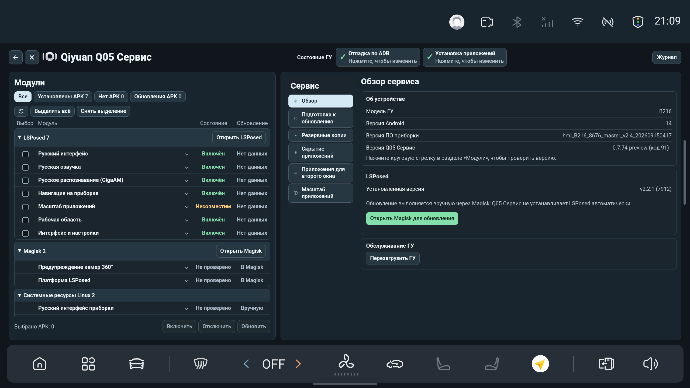
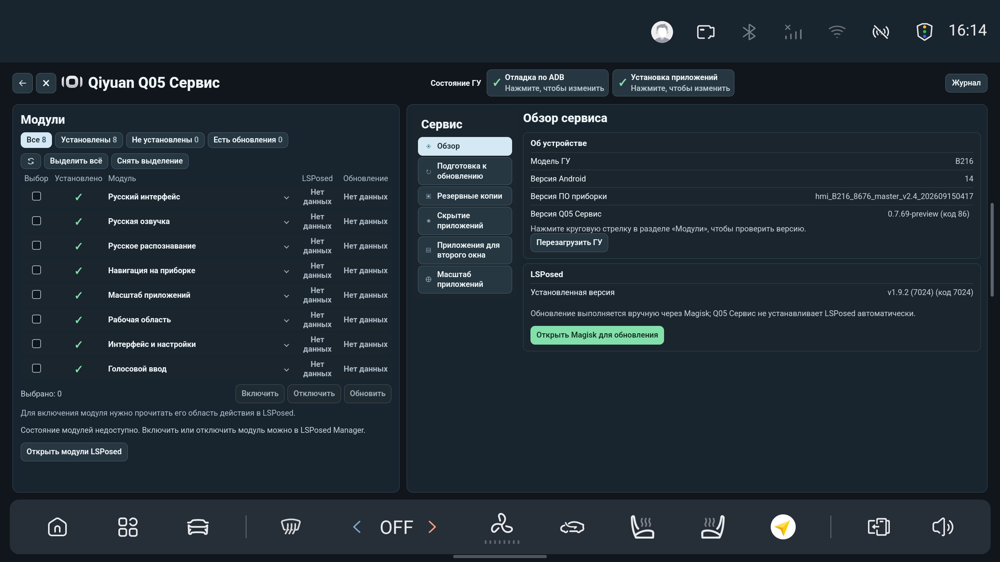
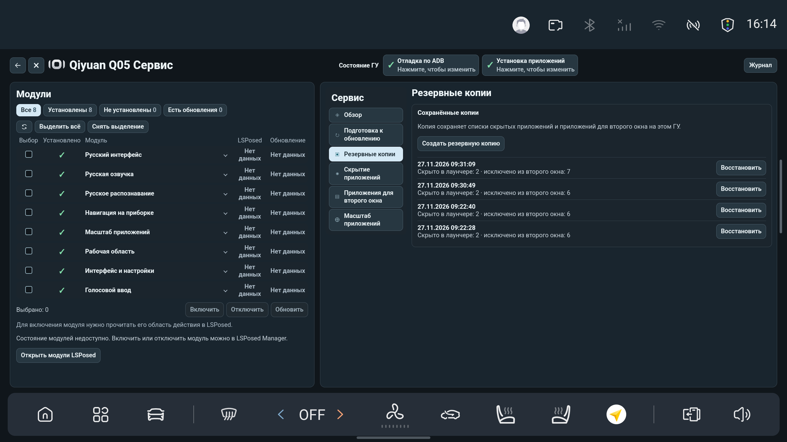
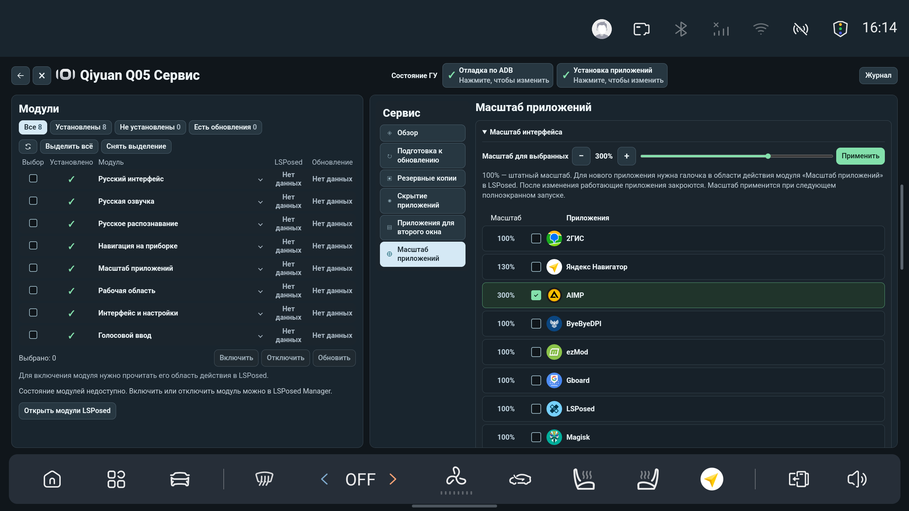
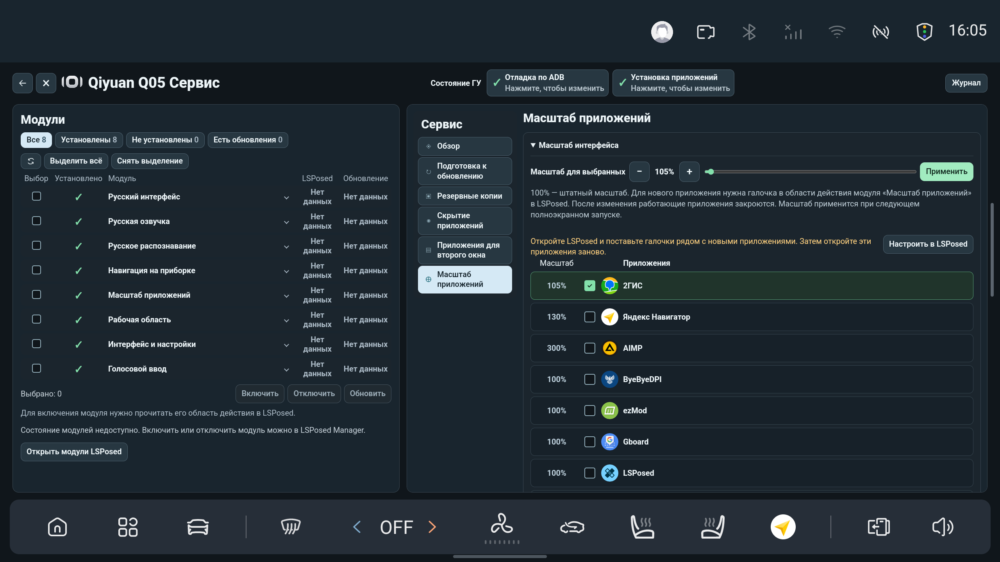
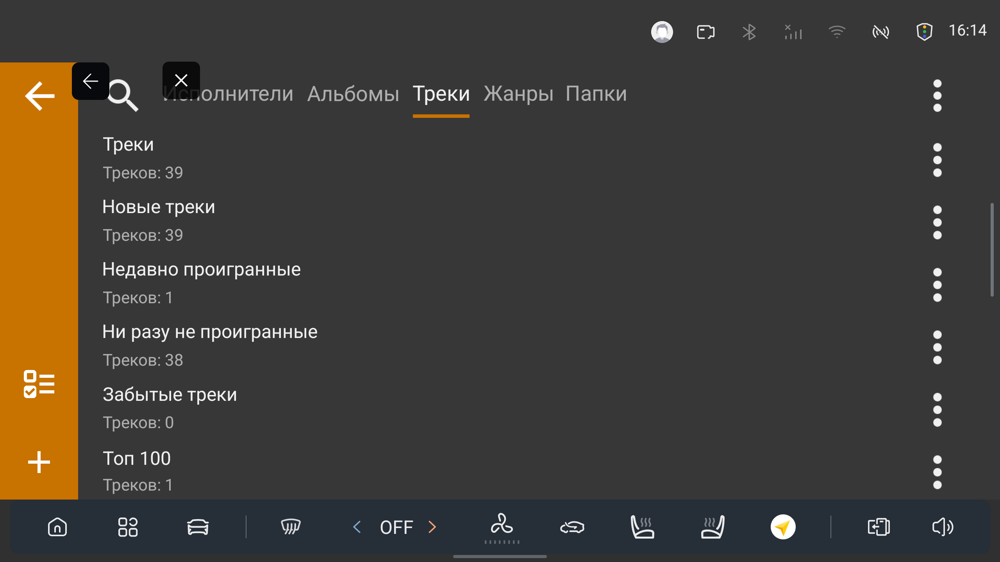
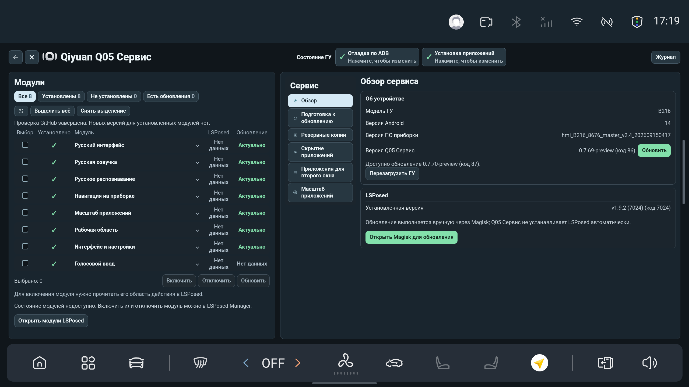

# Qiyuan Q05 Сервис на B216

## Сервис 0.7.74-preview (код 91)

Обзор на ГУ с LSPosed 2.2.1. Слева видны группы LSPosed, Magisk и ресурсов Linux. Сервис считал статусы шести включённых модулей и выделил установленный «Масштаб приложений» с API 100 как несовместимый с этой версией LSPosed.

## Проверка предыдущей сборки

Кадры ниже сняты с Сервисом 0.7.69-preview (код 86) и LSPosed 1.9.2. Для AIMP тогда подтвердили изменение плотности со 160 до 480 DPI при 300%.

